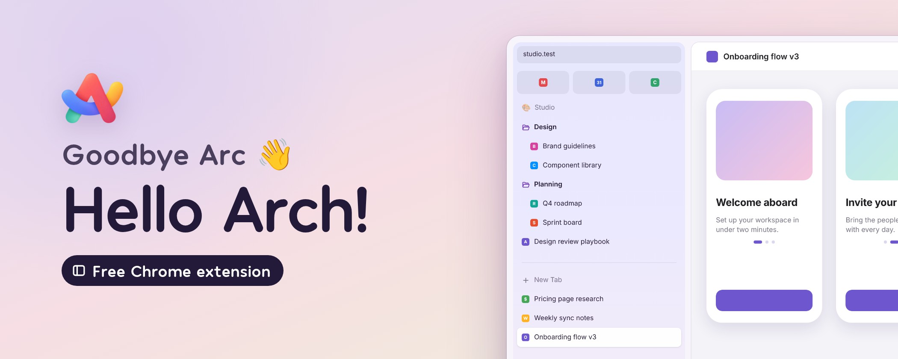
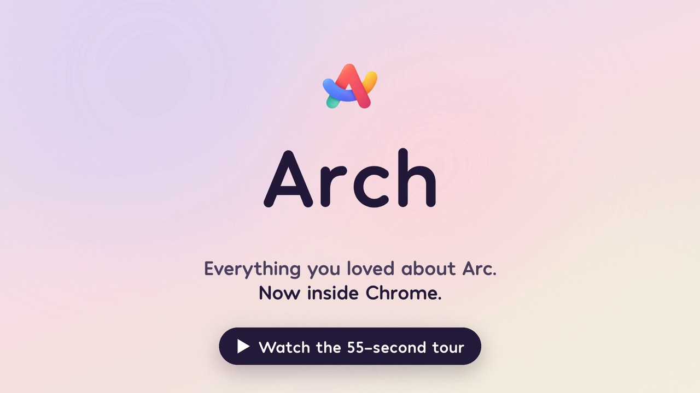
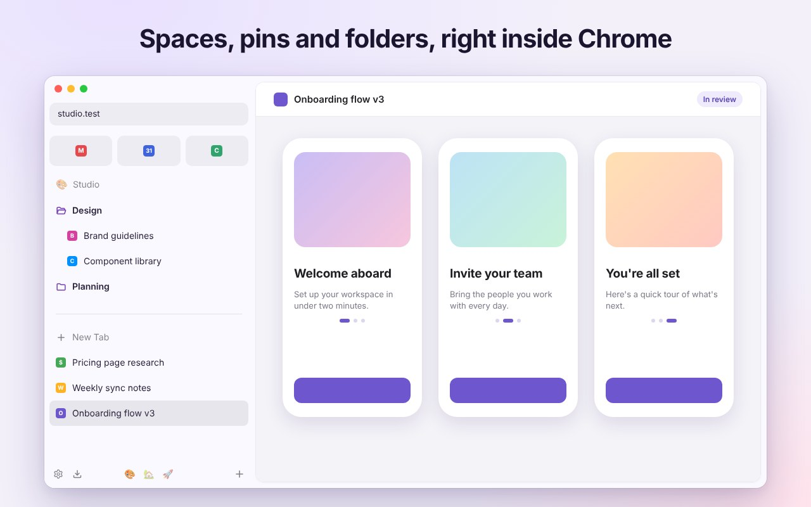
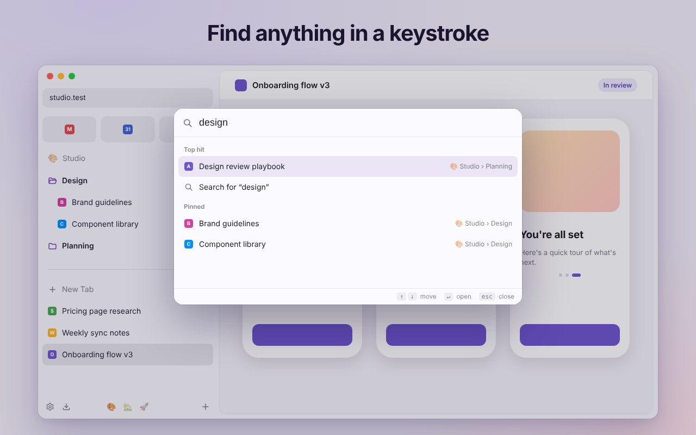
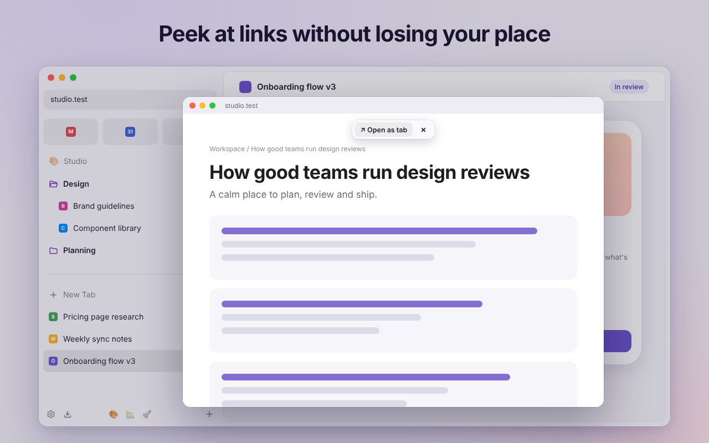
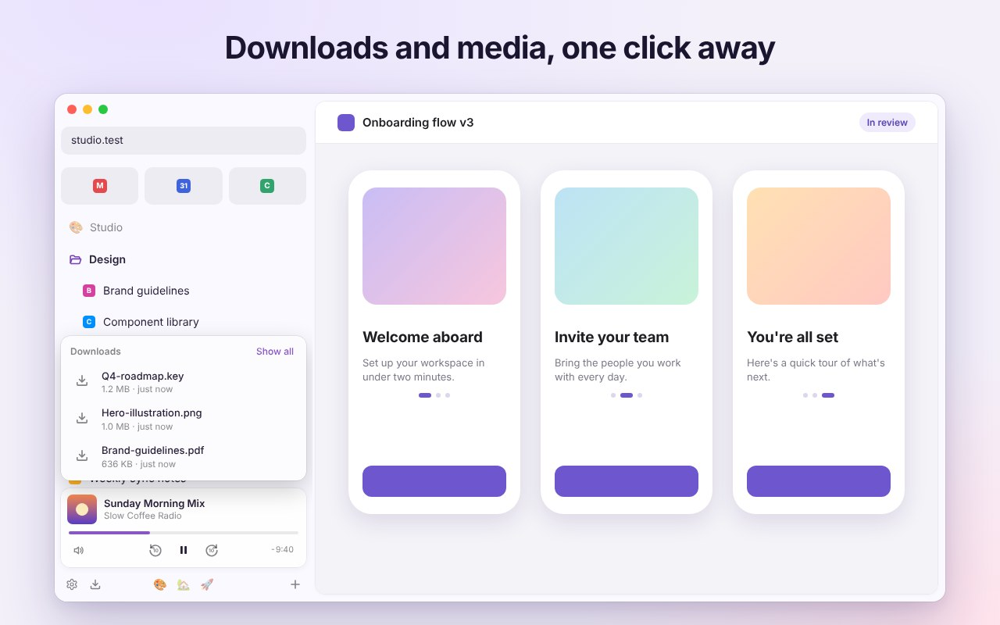

  

  <b>Arc's sidebar, rebuilt for Chrome.</b> 
  Spaces, pinned tabs, folders, favorites, a command bar, Peek and more, right inside the Chrome you already use.

  <a href="https://github.com/thejoelcook/arch/releases/latest/download/arch.zip"><b>Download arch.zip</b></a>
  &nbsp;·&nbsp;
  <a href="#install">How to install</a>
  &nbsp;·&nbsp;
  <a href="https://www.youtube.com/watch?v=4-g84lWQIEY">Watch the tour</a>

  

## A look inside

<table>
  <tr>
    <td width="50%"> <b>Spaces, pins and folders</b> Separate spaces for work, home and side projects. Pinned tabs stay put, even after you close them.</td>
    <td width="50%"> <b>Find anything in a keystroke</b> One shortcut searches open tabs, pins, bookmarks and history, and runs quick actions.</td>
  </tr>
  <tr>
    <td width="50%"> <b>Peek at links</b> Shift-click a link to open it in a floating window. Keep it as a tab or close it with Esc.</td>
    <td width="50%"> <b>Downloads and media, one click away</b> Recent downloads and controls for whatever is playing in other tabs.</td>
  </tr>
</table>

Coming from Arc? Arch imports your spaces, pinned tabs, folders and favorites in about a minute.

Arch is an independent project and isn't affiliated with The Browser Company or Arc.

## Install

Arch isn't in the Chrome Web Store yet, so for now you install it by hand. It takes about a minute.

1. Go to the [latest release](../../releases/latest) and download **arch.zip**.
2. Unzip it somewhere it can stay, like your Documents folder. Chrome loads Arch from this folder, so don't delete it.
3. Open `chrome://extensions` and turn on **Developer mode** (top right).
4. Click **Load unpacked** and pick the unzipped folder.
5. Pin Arch from the puzzle-piece menu and click its icon to open the sidebar. The welcome page walks you through the rest, including importing from Arc and setting ⌘S.

**Updating:** download the new **arch.zip**, replace the files in your Arch folder, then click the reload arrow on Arch's card in `chrome://extensions`. Your spaces and pins are kept.

Chrome may show a "Disable developer mode extensions" warning when it starts. That's normal for extensions installed this way; click the × to dismiss it.

## How it works

- **Spaces** are Chrome tab groups under the hood, one per space. Switching a space expands its group and collapses the rest. New tabs join the active space. Switch with the dock, `Alt+Shift+←/→` (`Ctrl+Shift` on Mac), or a sideways two-finger swipe in the sidebar.
- **Pinned** items belong to a space and survive closing. Drag a tab into the Pinned area to pin it, drag pins into folders, drag a pin down to Today to unpin. Closing a pinned tab keeps the pin. Right-click a pin to jump back to its original URL or re-pin the current one.
- **Favorites** are Chrome's own pinned tabs, shown as icon tiles at the top.
- **Auto-archive** closes tabs you haven't touched in 12 hours by default (change it in Settings). Archived tabs are searchable from the box icon in the dock, and click to restore. Pinned tabs, favorites and tabs playing audio are never archived.
- **Picture-in-picture**: a video playing with sound floats when you switch away from its tab and closes when you return. Chrome may ask once per site; manage it in Site settings under Automatic picture-in-picture.

## Importing from Arc

Open Settings (gear icon) > Import from Arc. If you turn on "Allow access to file URLs" for Arch in chrome://extensions, it finds Arc's file for you. Otherwise choose `StorableSidebar.json` from `~/Library/Application Support/Arc/` (press Cmd+Shift+G in the file picker and paste the path). Your spaces, pinned tabs, folders and favorites come across; split views become plain pinned tabs.

Data lives in `chrome.storage.local` on this computer.

## Command bar, copy URL, backup

- **Command bar**: Cmd+Shift+Space by default (set your own at chrome://extensions/shortcuts). Searches open tabs, pinned tabs across all spaces, bookmarks, history and the archive, plus actions like Copy URL, Mute tab, Switch to space. Type a URL to open it or anything else to search.
- **Copy URL**: assign a shortcut (for example Shift+Cmd+C) to "Copy the current URL" at chrome://extensions/shortcuts. Shift+Cmd+C also works whenever the sidebar is focused.
- **Backup**: Settings > Backup > Export saves spaces, pins, folders, favorites and settings to a JSON file. Restore brings them back, replacing the current setup.

## Now Playing

When a tab you're not looking at plays audio or video, a mini player appears at the bottom of the sidebar with artwork, title, play/pause, skip 10 seconds, a seekable progress bar and mute. Click the title or artwork to jump to the tab; the x pauses and dismisses it.

## Peek

Shift-click a link (or Option-click, set in Settings > Links) to open it in a floating window over Chrome. The toolbar at the top has Open as tab (moves it into your current space) and close. Esc or clicking back into the main window also closes it. Right-click any link for Open link in Peek.

## Downloads, Tidy, Sync

- **Downloads**: the tray button next to the gear shows recent downloads. Drag a file out into any app, click to open, or right-click for Show in Finder, Pause/Cancel, Remove, Delete. A dot and a toast appear when a download finishes.
- **Tidy**: hover the divider above Today and click Tidy to close duplicate tabs and sort the rest by site. Tabs that are playing audio, and the tab you're on, are never closed.
- **Sync across computers** (Settings > Data): spaces, pins, folders, emoji, colors and portable settings sync through your Chrome account. Favorites, open tabs and the archive stay per computer. Chrome's sync storage holds about 100 KB, roughly a few hundred pins.

## Credits

Emoji names and keywords come from [Emojibase](https://emojibase.dev) (MIT license). The gear icon is from [Lucide](https://lucide.dev) (ISC license).
